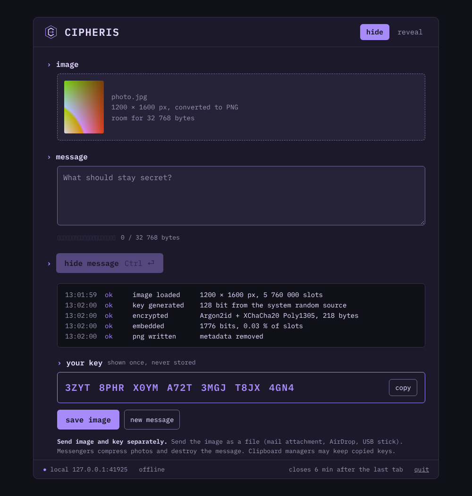

<p align="center"></p>

<h1 align="center">CIPHERIS</h1>

<p align="center">Encrypted messages, hidden inside images. Offline, on your own computer.</p>

<p align="center"><b>English</b> · <a href="README.de.md">Deutsch</a> · <a href="README.tr.md">Türkçe</a></p>



CIPHERIS encrypts a text message and hides it in a picture. The picture looks the same; only someone with the generated key can read the message again. Everything runs locally: no account, no cloud, no network access.

## Install

**Download (recommended):** get the file for your system from [Releases](../../releases).

| System | File | First start |
| --- | --- | --- |
| macOS (Apple Silicon and Intel) | `CIPHERIS-macOS.zip` | unzip, drag `CIPHERIS.app` into Applications, open it once (see below) |
| Windows | `CIPHERIS-Windows.zip` | unzip, double click `CIPHERIS.exe`; if Windows warns, choose *More info*, then *Run anyway* |
| Linux | `CIPHERIS-Linux.tar.gz` | unpack and run `./cipheris` |

**First start on macOS.** The app is not notarized by Apple, so macOS blocks the first start. On macOS 15 and later: try to open it once, then go to *System Settings*, *Privacy & Security*, scroll down and click *Open Anyway*. On older macOS: right click the app and choose *Open*. This is needed only once.

Each release lists SHA256 checksums in `SHA256SUMS.txt`. Check your download with `shasum -a 256 <file>` (macOS, Linux) or `Get-FileHash <file>` (Windows) before the first start. The apps are not signed with a paid Apple or Microsoft certificate, which is why the first start shows a warning.

**Build it yourself (macOS):** install Rust once with `curl --proto '=https' --tlsv1.2 -sSf https://sh.rustup.rs | sh`, then double click `Build Mac App.command`. The first build downloads the exact compiler version the project is tested with (Rust 1.97.0, set in `rust-toolchain.toml`). It creates `dist/CIPHERIS.app`. For a quick try without building the app, double click `Start CIPHERIS.command`.

**Any system:** `cargo run --release`

On macOS and Windows CIPHERIS opens in its own window; on Linux it opens in your browser. Either way it only talks to your own computer. The interface speaks English, German and Turkish; it follows your system language and can be switched in the title bar. In the window, saved pictures go to your *Downloads* folder, which then opens. The window uses the web view built into the system; on Windows that is Microsoft Edge WebView2, included in Windows 10 and 11. If it is missing, CIPHERIS opens in the browser instead. It stops when you press *quit*, or by itself a few minutes after you close its tab.

## Use

**Hide a message**

1. Drop a picture into the *image* field. Photos (JPEG, HEIC and others) are converted to PNG.
2. Type the message. The meter shows how much of the picture it uses.
3. Press *hide message*, then *save image*, and copy the key.

**Read a message**

1. Switch to *reveal* and drop the PNG file CIPHERIS created.
2. Type or paste the key. Case, spaces and dashes do not matter, and typos are detected.
3. Press *reveal message*.

**Keep in mind**

* Without the key the message is gone. There is no recovery.
* Send picture and key through different channels.
* Send the picture as a **file** (mail attachment, AirDrop, USB stick, cloud link). Messengers and social networks compress pictures and destroy the message.
* Use every picture only once, and do not share the original next to the new one.
* In a browser (Linux), extensions that can read every page can also read CIPHERIS. For sensitive messages use a browser profile without extensions. The app window on macOS and Windows has none.

## What CIPHERIS protects, and what it does not

| Property | Status |
| --- | --- |
| The message is unreadable without the key | Yes. Argon2id and XChaCha20 Poly1305, a fresh random 128 bit key per message. |
| A changed or damaged picture is detected | Yes. Any change to the hidden data gives "No message found", never wrong text. |
| Without the key there is no marker to find | Yes. Positions depend on the key; nothing sits at a fixed place. |
| Metadata of the original (EXIF, GPS, camera) | Removed from the new picture. |
| Nobody can even suspect a hidden message | **Not guaranteed.** Statistical analysis can detect hidden data, especially long messages in small pictures. CIPHERIS warns above 5 % use. |
| Protection on a computer with malware | No. See [docs/THREAT_MODEL.md](docs/THREAT_MODEL.md). |

More detail: [security policy](SECURITY.md), [threat model](docs/THREAT_MODEL.md), [security review against the hardening checklist](docs/SECURITY_REVIEW.md), [file format](docs/FORMAT.md), [design](docs/DESIGN.md). CIPHERIS has not had an external security audit.

## Upgrading from SSS

CIPHERIS was called SSS before version 0.2.0. Pictures and keys made with SSS open unchanged; a test pins this. Keys with dashes (old style) and with spaces (new style) both work.

## Project layout

| Path | Contents |
| --- | --- |
| `crates/core` (`cipheris_core`) | encryption envelope: Argon2id, XChaCha20 Poly1305, authenticated header, resource limits |
| `crates/stego` (`cipheris_stego`) | key format, PNG handling, key dependent placement, LSB matching |
| `crates/app` (`cipheris`) | local server on 127.0.0.1 and the interface (HTML, CSS, JavaScript, fonts, all compiled in) |
| `tools/crosscheck.py` | independent decoder (OpenSSL and libsodium) that checks the file format |
| `tools/e2e/ui.test.mjs` | browser test of the whole interface |
| `tools/audit_lock.py`, `tools/sbom.py` | offline vulnerability check of `Cargo.lock` and the SBOM generator |
| `fuzz/` | fuzzing targets for `cargo fuzz` |
| `packaging/` | logos, icons and the macOS build script |
| `docs/` | threat model, security review, format, design |

## Development

```sh
cargo fmt --all --check
cargo clippy --workspace --all-targets -- -D warnings
cargo test --workspace
python3 tools/crosscheck.py crates/core/tests/vectors/v1_cheap.hex "correct horse battery staple" "byte-exact payload"
cargo build --release && node tools/e2e/ui.test.mjs target/release/cipheris
cargo run --release -p cipheris_stego --example stego_report -- your_photo.png
cargo run --release -p cipheris_stego --example fuzz_campaign -- 60
cargo run --release -p cipheris --example http_fuzz -- 60
git clone --depth 1 https://github.com/rustsec/advisory-db /tmp/advisory-db && python3 tools/audit_lock.py Cargo.lock /tmp/advisory-db
```

The continuous integration in `.github/workflows/ci.yml` runs all of this on Linux, macOS and Windows, plus `cargo deny` for known vulnerabilities and licences. Releases are built by `.github/workflows/release.yml`.

## Licence

MIT, see [LICENSE](LICENSE). IBM Plex Mono is included under the SIL Open Font License, see `crates/app/ui/fonts/OFL.txt`.
